# EcoSort

Evidența colectării selective a deșeurilor la CEITI.

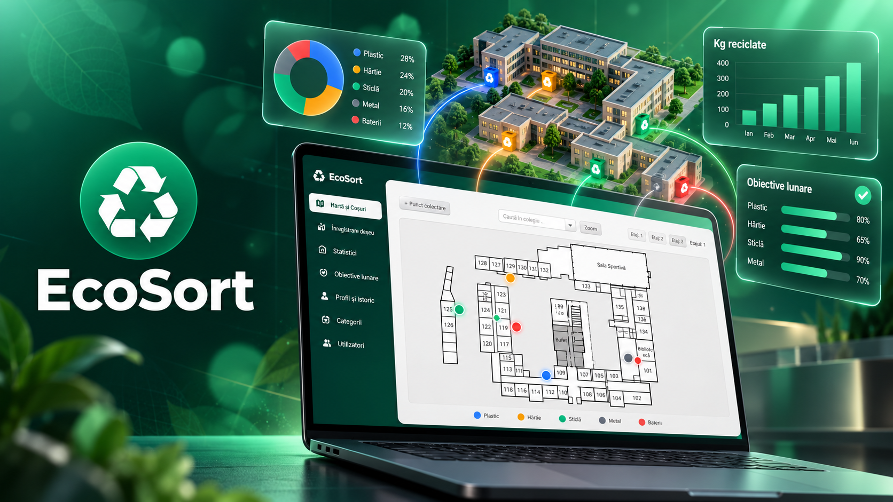

EcoSort este o aplicație desktop în care se înregistrează deșeurile predate la reciclare (plastic, hârtie,
sticlă, metal, baterii). Aplicația arată pe harta colegiului unde sunt coșurile de colectare și cât s-a
colectat în fiecare lună.

Pentru lucrătorii care golesc coșurile există și o [aplicație mobilă Android](#aplicația-mobilă).

## Participanți

- Marțenco Mihail — [@Mihail-pro](https://github.com/Mihail-pro)
- Ghilan Adrian — [@ghilanadrian7-prog](https://github.com/ghilanadrian7-prog)
- Găină Valentin — [@00NYXth](https://github.com/00NYXth)
- Lazari Daniel — [@FROZEN263](https://github.com/FROZEN263)

## Instalare și pornire

### 1. Instalează Java și Docker Desktop

Se face o singură dată.

- Java: [adoptium.net](https://adoptium.net). Descarcă, deschide fișierul și urmează pașii instalării.
- Docker Desktop: [docker.com/products/docker-desktop](https://www.docker.com/products/docker-desktop).
  Descarcă, deschide fișierul și urmează pașii instalării. Dacă cere repornirea calculatorului, repornește-l.
  Contul Docker nu este necesar.

### 2. Descarcă proiectul

1. Pe această pagină apasă butonul verde `Code`, apoi `Download ZIP`.
2. Click dreapta pe fișierul descărcat, apoi `Extract All` (Extrage tot).

### 3. Pornește aplicația

În folderul extras, dublu-click pe `porneste.bat`.

Se deschide o fereastră în care apar pașii pornirii. Prima pornire durează câteva minute. Nu închide
fereastra până nu se deschide aplicația.

Dacă Windows afișează un avertisment de securitate, alege `More info`, apoi `Run anyway`.

### 4. Creează contul de administrator

La prima pornire aplicația cere crearea contului de administrator: nume de utilizator, nume complet și o
parolă de cel puțin 8 caractere.

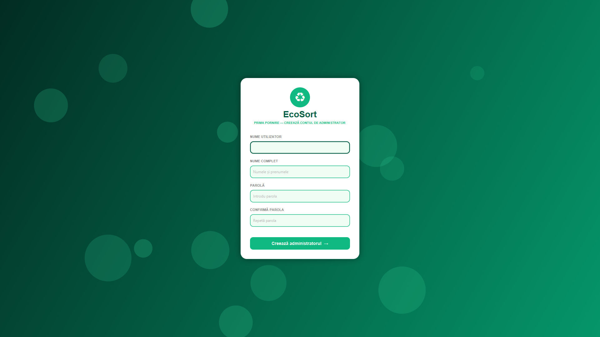

Celelalte conturi se creează din aplicație, în secțiunea Utilizatori.

Pentru următoarele porniri este suficient dublu-click pe `porneste.bat`. Datele rămân salvate.

## Secțiunile aplicației

### Autentificare

Fiecare utilizator intră cu contul propriu.

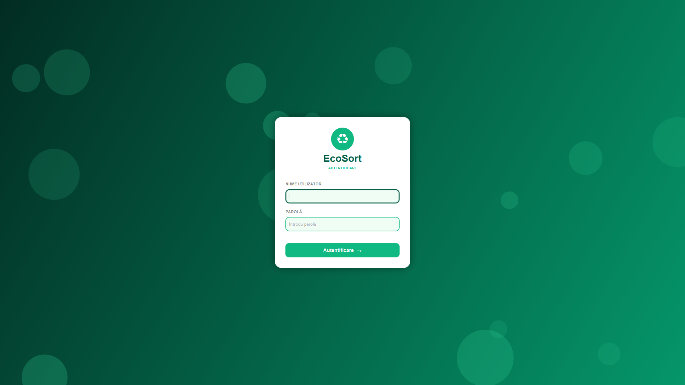

### Hartă și coșuri

Harta colegiului, pe etaje. Fiecare punct colorat este un coș de colectare; culoarea indică categoria.
Administratorul adaugă un coș cu butonul `+ Punct colectare` și un click pe încăpere, iar un click pe coș
îl șterge.

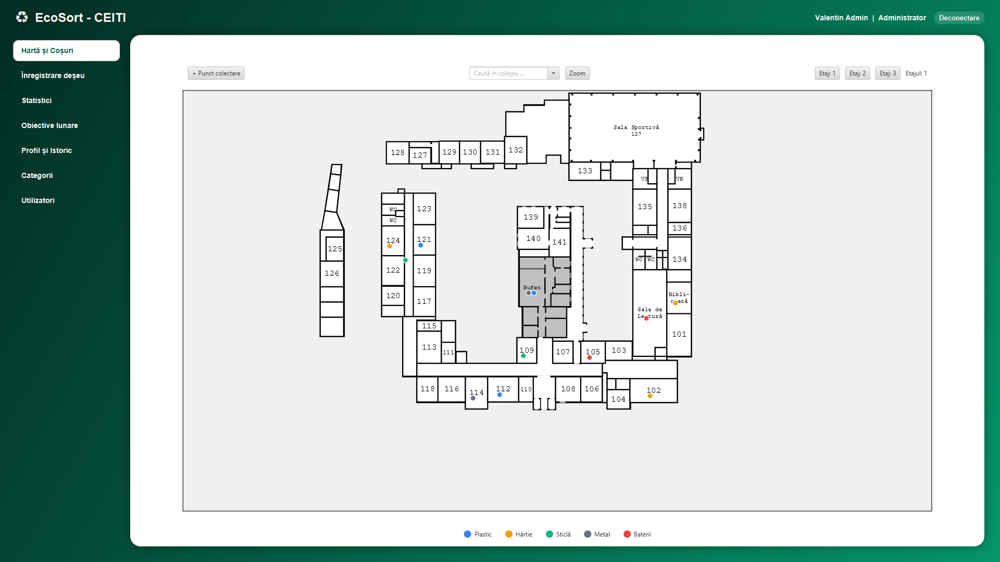

### Înregistrare deșeu

Se completează categoria, coșul (opțional), cantitatea în kilograme și data.

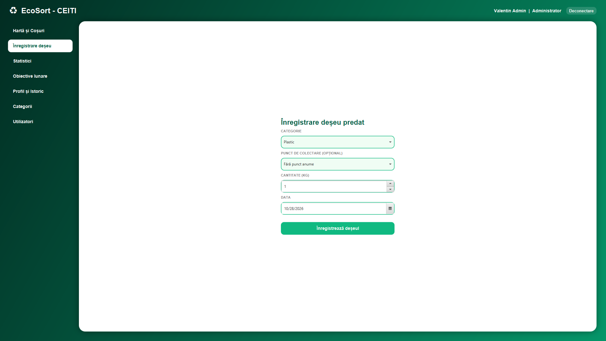

### Statistici

Cantitățile colectate în tot colegiul pe categorii, pentru ziua curentă, luna curentă, anul curent sau în
total, și lista înregistrărilor. O înregistrare se modifică prin dublu-click sau cu butonul `Editează`.

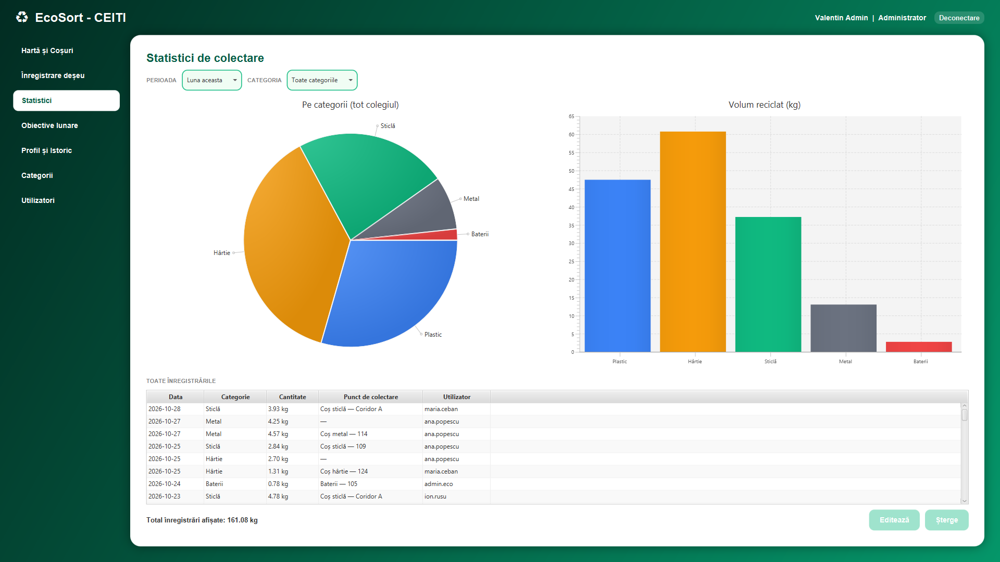

### Obiective lunare

Ținta pe luna curentă pentru fiecare categorie și cât s-a colectat până acum. Țintele le stabilește
administratorul.

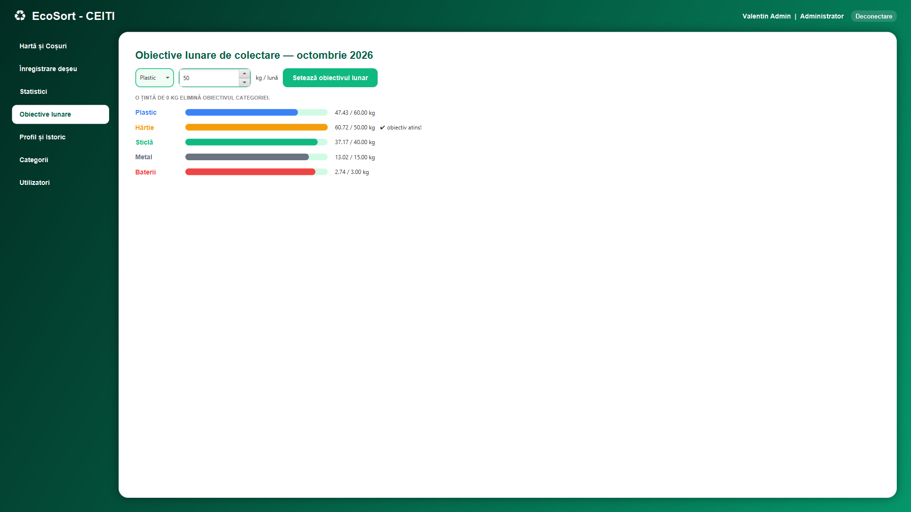

### Profil și istoric

Totalul colectat de utilizator și lista înregistrărilor lui.

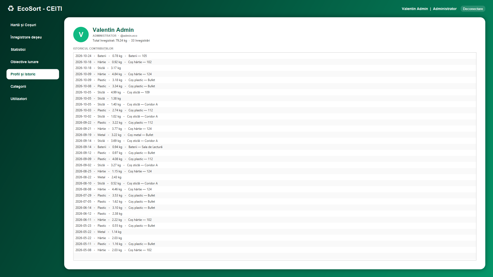

### Categorii

Doar pentru administrator. Adăugarea, modificarea și ștergerea categoriilor de deșeuri.

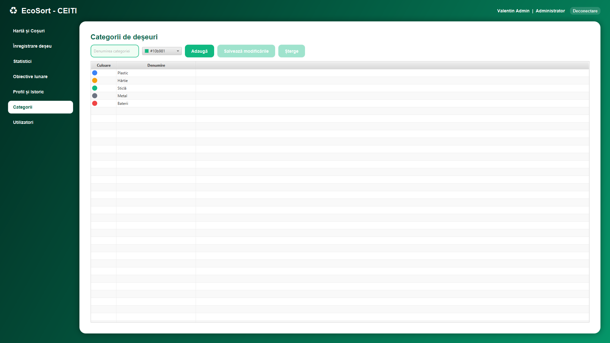

### Utilizatori

Doar pentru administrator. Crearea conturilor, schimbarea rolului, dezactivarea unui cont și resetarea
parolei.

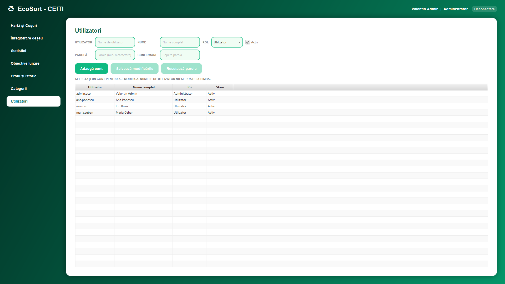

## Aplicația mobilă

Aplicația Android EcoSort Mobile (folderul [`mobile/`](mobile/)) este pentru lucrătorii care golesc coșurile.
Pe harta colegiului vede ce coșuri sunt pline, scanează codul QR al coșului și confirmă golirea. Umplerea și
greutatea sunt măsurate de senzorii coșului, iar fiecare golire ajunge în istoric și în statistici.

  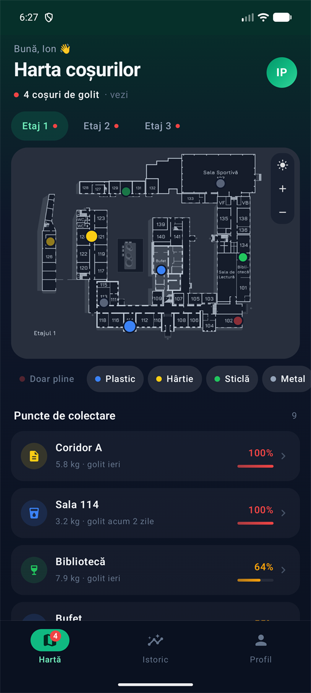
  &nbsp;
  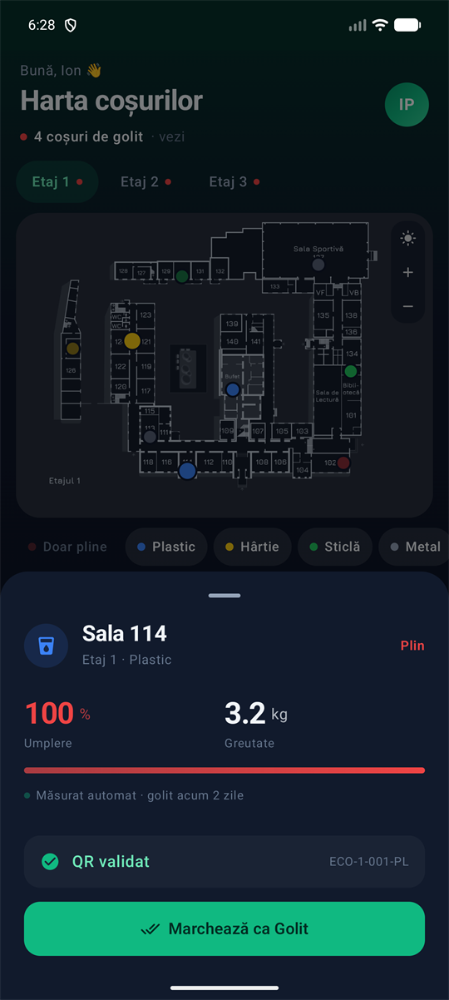
  &nbsp;
  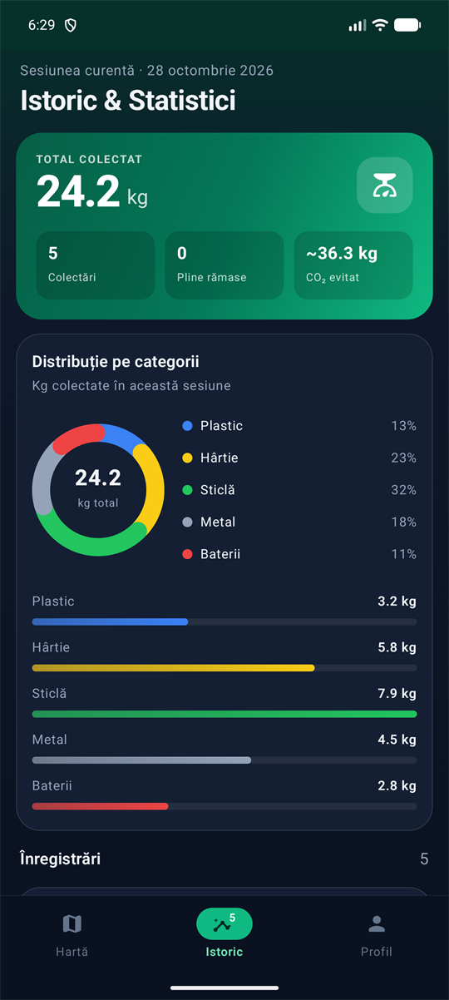

Este o versiune Beta (prototip demo) cu date simulate local. Descrierea completă, toate ecranele și pașii de
rulare: [mobile/README.md](mobile/README.md).

## Probleme frecvente

| Mesaj | Soluție |
|-------|---------|
| Java nu este instalat | Instalează Java (pasul 1), apoi pornește din nou `porneste.bat`. |
| Docker Desktop nu este instalat | Instalează Docker Desktop (pasul 1), apoi pornește din nou `porneste.bat`. |
| Docker Desktop nu a pornit | Deschide Docker Desktop din meniul Start, așteaptă mesajul „Engine running”, apoi pornește din nou `porneste.bat`. |
| Nu se poate conecta la baza de date | Închide aplicația și pornește din nou `porneste.bat`. |
| Dublu-click pe `porneste.bat` nu face nimic | Arhiva ZIP nu a fost extrasă. Vezi pasul 2. |

Pentru alte erori, trimite echipei o captură a ferestrei `porneste.bat`.

## Dezvoltatori

Configurare, rulare din IntelliJ, baza de date, teste și arhitectură: [docs/DEZVOLTATORI.md](docs/DEZVOLTATORI.md).
