# EcoSort Mobile

Aplicația Android pentru lucrătorii care golesc coșurile de colectare selectivă din CEITI.

Pe telefon, lucrătorul vede pe harta colegiului ce coșuri sunt pline, merge la ele, scanează codul QR al
coșului și confirmă golirea. Nivelul de umplere și greutatea sunt măsurate de senzorii coșului, așa că nu
trebuie introdus nimic manual. Fiecare golire ajunge în istoric și în statistici.

<p align="center">
  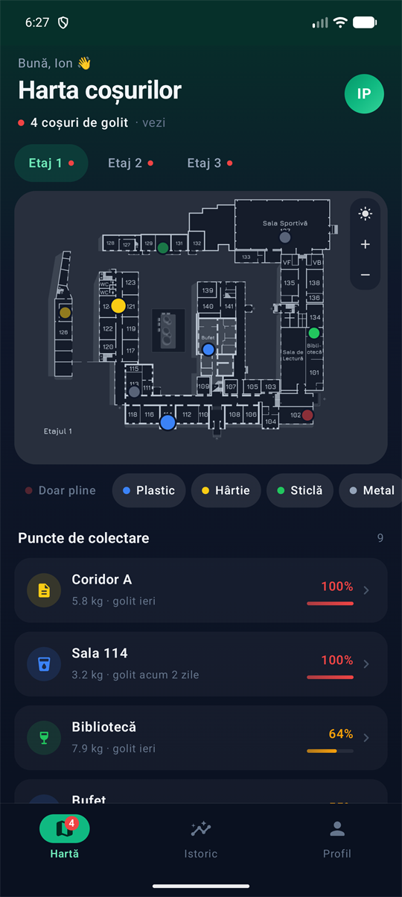
  &nbsp;
  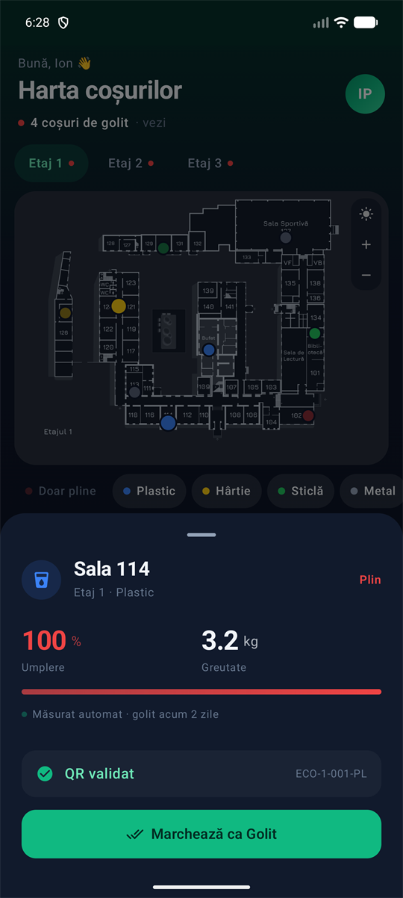
  &nbsp;
  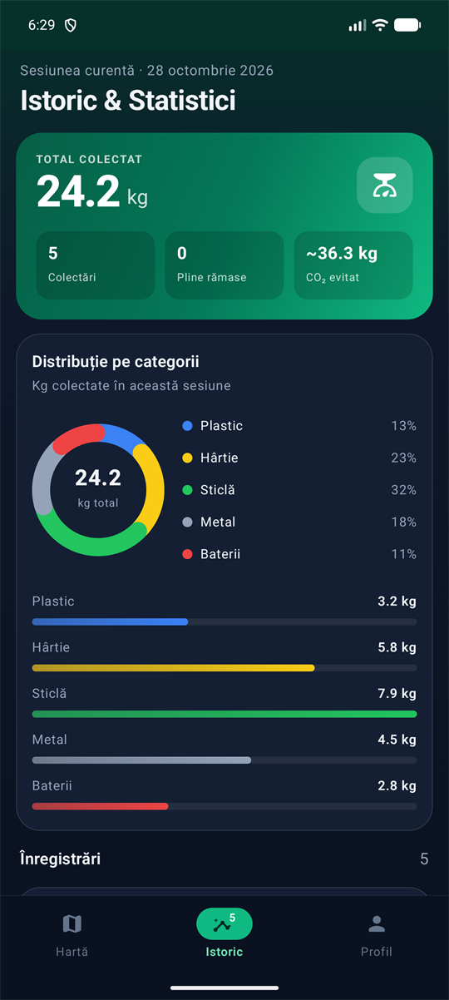
</p>

Versiune Beta (prototip demo): aplicația nu folosește backend. Utilizatorii, coșurile și istoricul sunt
simulate local și se resetează la repornire.

## Cum funcționează

### 1. Autentificare

Fiecare lucrător intră cu contul propriu. Pentru demonstrație există două conturi de test și butonul
„Autentificare Rapidă Demo”, care intră direct cu primul cont. La o parolă greșită apare un mesaj de eroare.

| Utilizator | Parolă | Nume |
|------------|--------|------|
| `sofer1` | `parola123` | Ion Popescu |
| `sofer2` | `parola123` | Vasile Ceban |

<p align="center">
  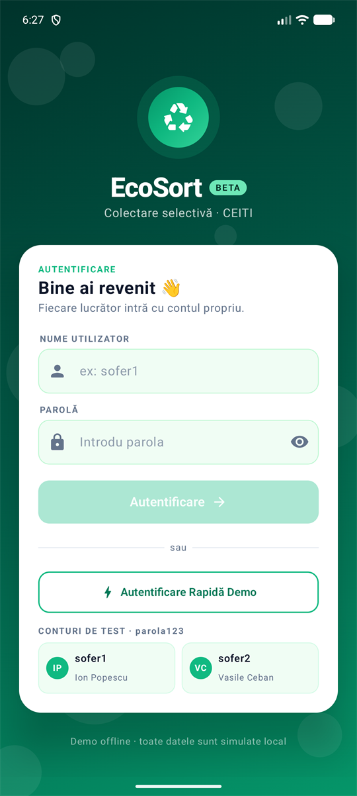
</p>

### 2. Harta coșurilor

Ecranul principal. Sus se vede câte coșuri trebuie golite; apăsarea pe acest rând arată doar coșurile pline.
Harta este schița reală a etajului, iar fiecare coș este un punct colorat după categorie:

| Culoare | Categorie |
|---------|-----------|
| Albastru | Plastic |
| Galben | Hârtie |
| Verde | Sticlă |
| Gri | Metal |
| Roșu | Baterii |

Coșurile pline sunt mai mari și pulsează cu un cerc roșu. Coșurile goale sunt estompate. Butonul din colțul
hărții schimbă între harta întunecată și schița originală, luminoasă.

<p align="center">
  
  &nbsp;
  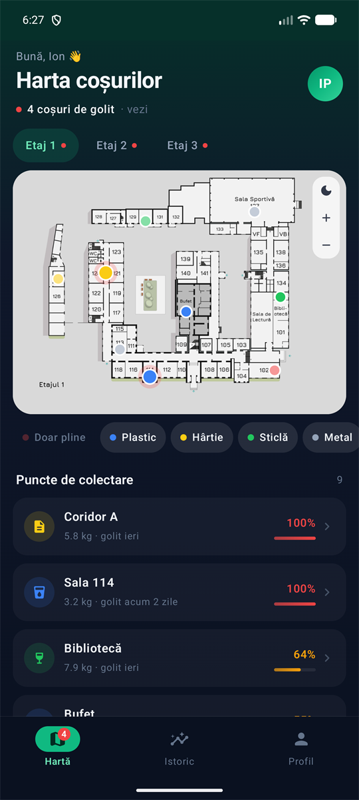
</p>

### 3. Etaje, zoom și filtre

- Etajele 1, 2 și 3 se schimbă din butoanele de sus. Un punct roșu lângă etaj arată că acolo există coșuri pline.
- Harta se mărește cu două degete, cu dublu-tap sau cu butoanele + și −. Punctele rămân pe camera corectă și
  își păstrează mărimea.
- Sub hartă, „Doar pline” ascunde coșurile care nu trebuie golite, iar categoriile pot fi activate sau
  dezactivate.
- Lista „Puncte de colectare” arată coșurile etajului, ordonate după umplere: sala, greutatea, când a fost
  golit ultima dată și procentul.

<p align="center">
  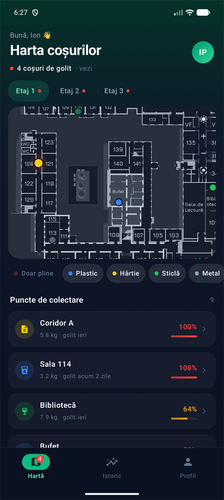
  &nbsp;
  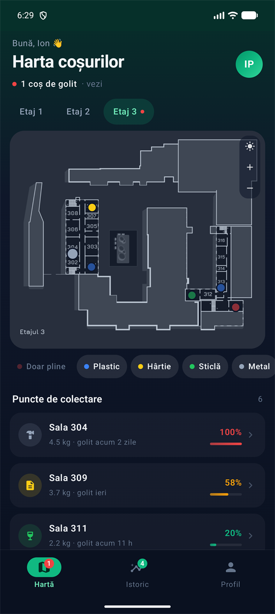
  &nbsp;
  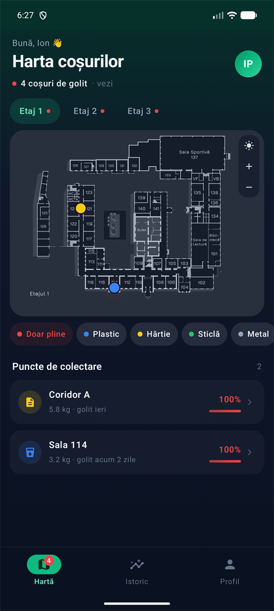
</p>

### 4. Golirea unui coș

1. Apasă pe un coș de pe hartă sau din listă. Se deschide fereastra coșului cu umplerea și greutatea
   măsurate automat.
2. Apasă „Simulează Scanare QR”. După validare apare codul coșului (de exemplu `ECO-1-001-PL`).
3. Apasă „Marchează ca Golit”. Coșul devine gol pe hartă, pulsul roșu dispare, iar golirea se salvează în
   istoric cu greutatea măsurată. Mesajul de jos are butonul „Anulează” pentru o golire făcută din greșeală.

<p align="center">
  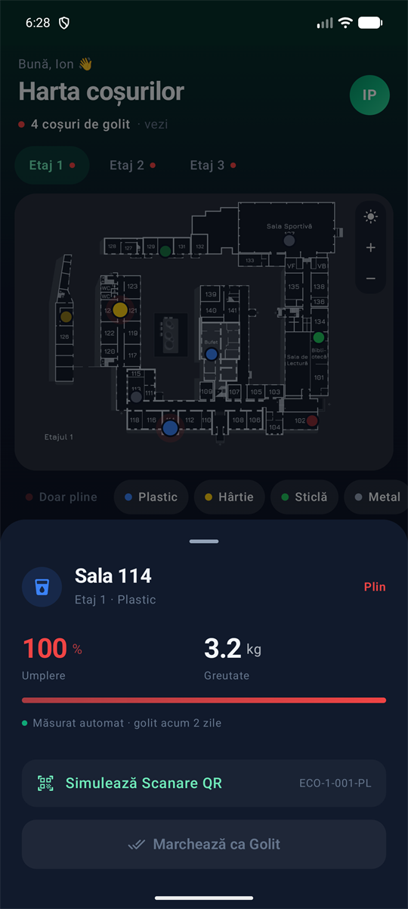
  &nbsp;
  
  &nbsp;
  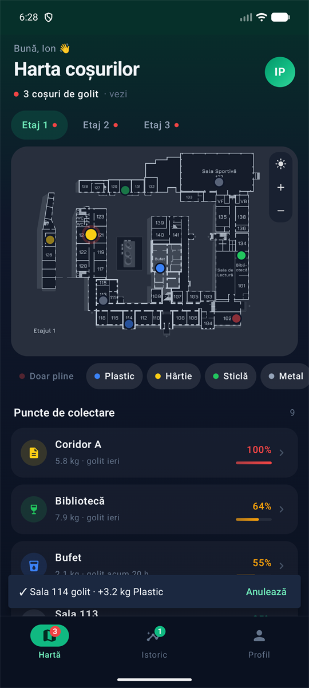
</p>

### 5. Istoric și statistici

Totalul de kilograme colectate în sesiune, numărul de colectări, coșurile pline rămase și distribuția pe
categorii. Mai jos este lista tuturor golirilor: categoria, sala, lucrătorul, etajul, ora și greutatea.

<p align="center">
  
  &nbsp;
  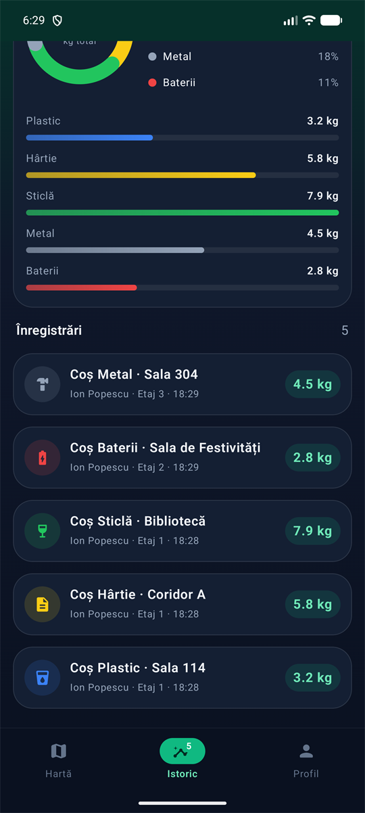
</p>

### 6. Profil și instrumente demo

Datele lucrătorului, rezultatele lui din sesiune și tura de azi. Secțiunea „Instrumente demo” ajută la
prezentare:

- **Senzori live** – la fiecare 5 secunde un coș aleator se umple și devine mai greu.
- **Umple 3 coșuri** – trei coșuri aleatorii devin pline imediat.
- **Resetează demo** – readuce coșurile și istoricul la starea inițială.

<p align="center">
  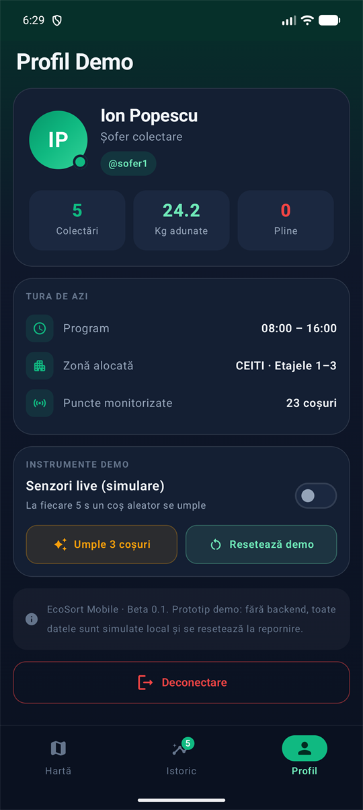
</p>

## Rulare

1. Instalează [Android Studio](https://developer.android.com/studio).
2. Deschide în Android Studio folderul `mobile/` (nu rădăcina repo-ului).
3. Așteaptă sincronizarea Gradle.
4. Alege un emulator sau un telefon conectat prin USB și apasă Run.

Cerințe: Android 8.0 sau mai nou (minSdk 26), compileSdk 37.

## Pentru dezvoltatori

Tehnologii: Kotlin, Jetpack Compose, Material 3, ViewModel cu StateFlow. Fără conexiuni de rețea.

```
app/src/main/java/md/ceiti/ecosort/
  EcoSortViewModel.kt      starea aplicației (StateFlow)
  data/Models.kt           User, TrashBin, Category, BinStatus, CollectionRecord
  data/MockData.kt         conturile de test și coșurile de pe fiecare etaj
  ui/login/                autentificare
  ui/map/                  hartă (FloorMap), listă coșuri, fereastra de golire
  ui/history/              istoric și statistici
  ui/profile/              profil și instrumente demo
  ui/theme/                culorile EcoSort Web și tipografia
```

- Poziția unui coș pe hartă este dată de `xRatio` și `yRatio` (0–1, relativ la imaginea etajului), în
  `data/MockData.kt`.
- Greutatea unui coș plin pe categorii se schimbă în `capacityKg` din `data/Models.kt`. Când va exista un
  cântar real, valoarea `weightKg` se înlocuiește cu citirea lui.
- Schițele etajelor sunt în `app/src/main/res/drawable-nodpi/`.
